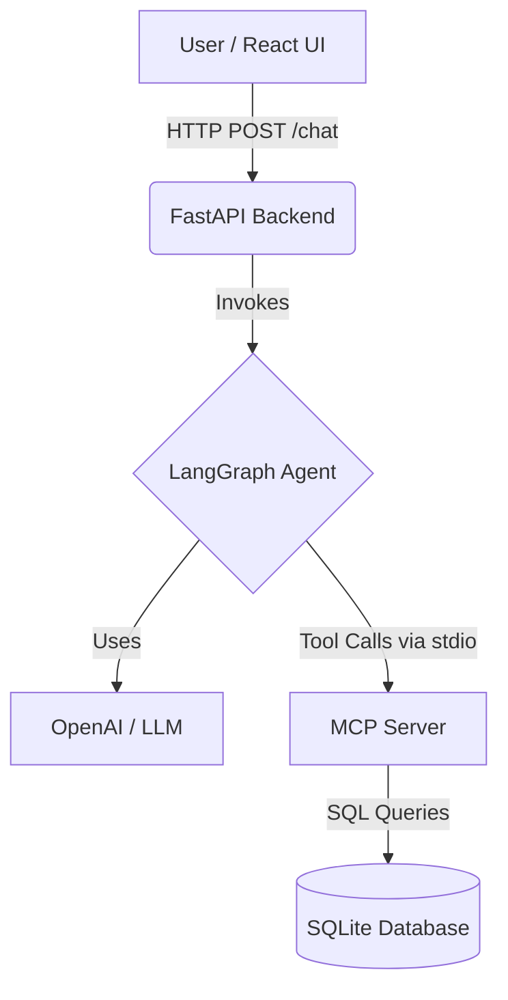
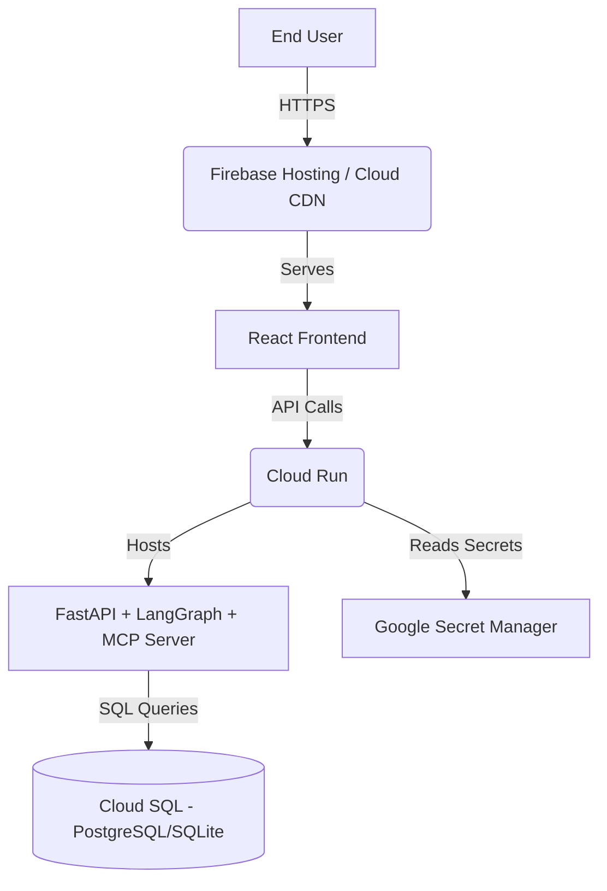

# Retail Inventory Assistant - Implementation Details

This document outlines the technical implementation of the Retail Inventory Assistant, detailing the architecture, data flow, and specific technologies used across the stack.

## System Architecture

The application is built using a modern decoupled architecture consisting of three main layers:

1. **Frontend (React)**: Handles user interaction and presents a chat interface.
2. **Backend (FastAPI + LangGraph)**: Serves as the middle tier, exposing APIs and orchestrating the AI logic.
3. **Model Context Protocol (MCP) Server**: Provides standardized access to the underlying SQLite database.



## 1. Frontend Implementation

- **Framework**: Built with React and initialized via Vite.
- **Styling**: Uses Vanilla CSS with CSS variables to ensure high performance while delivering a premium aesthetic (glassmorphism, dark mode, micro-animations).
- **Logic**: The `App.jsx` component maintains the chat state (array of messages) and handles the asynchronous API calls to the backend via the native `fetch` API. It includes auto-scrolling to the latest message, handles loading states during AI generation, and securely injects the `X-API-Key` header into outgoing requests.

## 2. Backend Orchestration (FastAPI & LangGraph)

The backend acts as the bridge between the frontend and the AI ecosystem.

- **FastAPI**: Provides a lightweight web server handling CORS and exposing the `POST /chat` endpoint.
- **Lifecycle Management**: Upon startup, the FastAPI app automatically spawns the `mcp_server/server.py` as a subprocess using `mcp.client.stdio.stdio_client`. It maintains this connection throughout the application lifecycle.
- **LangGraph**: 
  - We use `create_react_agent` to instantiate an agent powered by an OpenAI model (e.g., `gpt-4o-mini`).
  - Tools are dynamically loaded from the MCP server using `langchain_mcp_adapters.tools.load_mcp_tools`. This means if the MCP server adds a new tool, the LangGraph agent automatically inherits it without backend code changes.

## 3. Model Context Protocol (MCP) Server

The MCP server is the dedicated data access layer.

- **FastMCP SDK**: We utilize the `fastmcp` library to quickly expose Python functions as standardized tools.
- **RAG Architecture**: The server initializes an `InMemoryVectorStore` from a local JSON file (`data/vector_store.json`), allowing the AI to search unstructured knowledge (markdown documents) using `OpenAIEmbeddings` and cosine similarity via `numpy`.
- **Exposed Tools**:
  1. `inventory.get_stock(product_id: str)`: Returns specific stock levels for a known product ID.
  2. `inventory.product_search(query: str)`: Performs a `LIKE` query against the SQLite database to find products matching the name or category.
  3. `search_knowledge_base(query: str)`: Executes a similarity search against the vector store to retrieve policy and product information.
  4. `forecast_demand(product_id: str)`: Computes a 30-day unit demand forecast utilizing historical sales (`sales_last_30d`) and trend multipliers (`seasonality_index`).
  5. `optimize_price(product_id: str)`: Recommends price adjustments (discounts or markups) by comparing current `stock_quantity` against forecasted demand, bounded by `cost_price` and `competitor_price_avg`.
- **Transport**: The server communicates via standard input/output (`stdio`), making it incredibly secure and easy to spawn locally.

## 4. Data Layer

- **Database**: SQLite (`data/inventory.db`).
- **Schema**: A single `products` table augmented for advanced forecasting:
  - `id` (TEXT, Primary Key)
  - `name` (TEXT)
  - `category` (TEXT)
  - `stock_quantity` (INTEGER)
  - `price` (REAL)
  - `cost_price` (REAL) - Base acquisition cost
  - `sales_last_30d` (INTEGER) - Historical sales volume
  - `seasonality_index` (REAL) - Multiplier for demand trends
  - `competitor_price_avg` (REAL) - Market average price
- **Initialization**: The `init_db.py` script reads from a mock `inventory.csv` file to populate the local database.

## Security & Environment

- **API Keys**: Sensitive credentials like `OPENAI_API_KEY` and the newly implemented `APP_API_KEY` are managed via standard `.env` files and `python-dotenv`, ensuring they are never hardcoded into the repository.
- **API Key Authentication**: The FastAPI backend is secured using the `APIKeyHeader` dependency. It rejects any request to `/chat` that does not contain a valid `X-API-Key` header, preventing unauthorized LLM usage.
- **CORS Hardening**: FastAPI is explicitly configured to only allow Cross-Origin Resource Sharing from the frontend origin (`http://localhost:5173`), dropping wildcard permissions.

---

## 5. Google Cloud Platform (GCP) Implementation Strategy

To transition this application from a local development environment to a production-ready Google Cloud deployment, the following architecture and services are recommended:

### Architecture Overview



### Component Breakdown

1. **Frontend Hosting (Firebase Hosting or Cloud Storage + CDN)**
   - Build the Vite React app for production (`npm run build`).
   - Deploy the static assets (`dist/`) to Firebase Hosting or a Google Cloud Storage bucket fronted by Cloud CDN for low-latency global access.

2. **Backend API & MCP Server (Google Cloud Run)**
   - **Containerization**: Create a `Dockerfile` in the root directory that installs the Python dependencies, copies the `backend/` and `mcp_server/` directories, and starts the FastAPI server using Uvicorn.
   - **Deployment**: Deploy the Docker container to **Google Cloud Run**, a fully managed, serverless execution environment that auto-scales based on traffic.
   - **Concurrency**: Cloud Run handles multiple concurrent requests, ensuring the LangGraph agent and MCP tools can operate efficiently.

3. **Data Layer Migration (Cloud SQL)**
   - **Limitation of Local SQLite**: Cloud Run container instances are stateless and ephemeral. Any writes to a local SQLite database inside the container will be lost upon restart.
   - **Solution**: Migrate the inventory data to **Cloud SQL** (PostgreSQL or MySQL).
   - **Implementation**: Update `mcp_server/db.py` to connect to the Cloud SQL instance using the Cloud SQL Python Connector.

4. **Secrets Management (Google Secret Manager)**
   - Store sensitive keys, such as the `OPENAI_API_KEY` and database credentials, in **Google Secret Manager**.
   - Cloud Run natively integrates with Secret Manager to inject these secrets into the container as environment variables at runtime.

### Step-by-Step Deployment Instructions

#### 1. Setup Google Cloud CLI
Ensure you have the `gcloud` CLI installed and authenticated:
```bash
gcloud auth login
gcloud config set project YOUR_PROJECT_ID
```

#### 2. Deploy Frontend to Firebase Hosting
```bash
# Install Firebase CLI
npm install -g firebase-tools
firebase login

# Initialize Firebase in your frontend directory
cd frontend
firebase init hosting
# (Select your project and set the public directory to 'dist')

# Build and Deploy
npm run build
firebase deploy --only hosting
```

#### 3. Containerize the Backend
Create a `Dockerfile` in your root directory for the FastAPI/MCP backend:
```dockerfile
FROM python:3.13-slim

WORKDIR /app
COPY requirements.txt .
COPY backend/requirements.txt backend/
RUN pip install -r requirements.txt -r backend/requirements.txt

COPY . .

# Expose FastAPI port
EXPOSE 8000

# Start Uvicorn
CMD ["uvicorn", "backend.main:app", "--host", "0.0.0.0", "--port", "8000"]
```

#### 4. Deploy Backend to Google Cloud Run
Push the code to Cloud Run directly using source deployment:
```bash
# Add your secret to Google Secret Manager
echo -n "sk-proj-YOUR_API_KEY" | gcloud secrets create OPENAI_API_KEY \
    --data-file=- \
    --replication-policy="automatic"

# Deploy to Cloud Run
gcloud run deploy retail-inventory-backend \
    --source . \
    --region us-central1 \
    --allow-unauthenticated \
    --set-secrets="OPENAI_API_KEY=OPENAI_API_KEY:latest"
```

Once deployed, Google Cloud Run will provide you with a secure `https://` URL. You must update your React frontend (`frontend/src/App.jsx`) to point all API requests to this new backend URL instead of `localhost:8000`, rebuild the frontend, and redeploy to Firebase.
